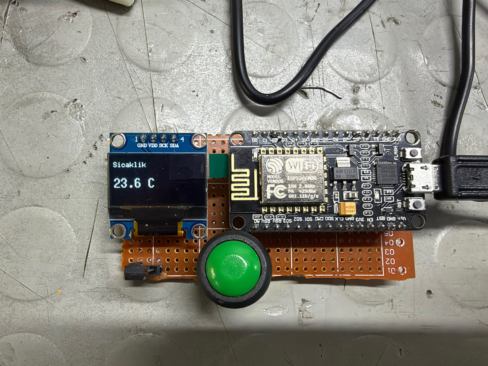
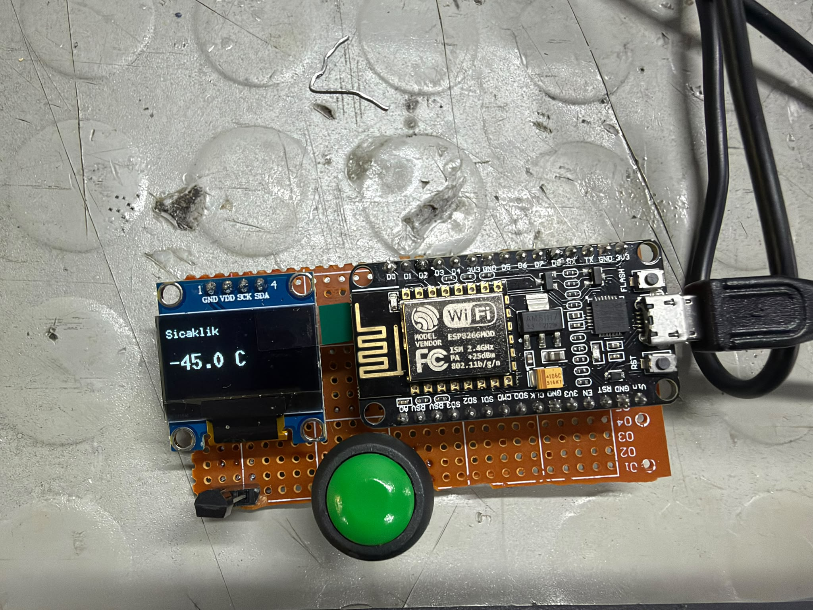
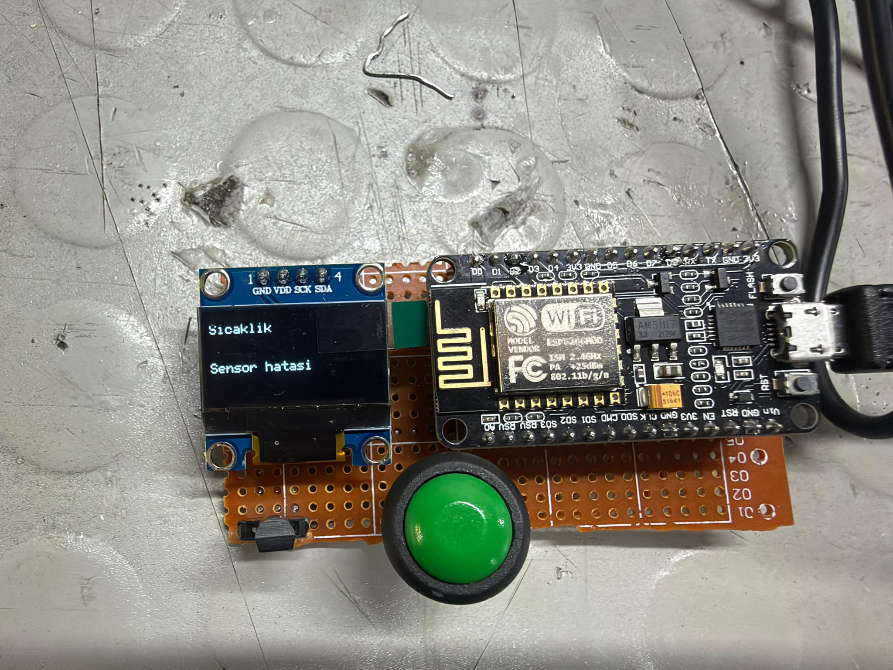
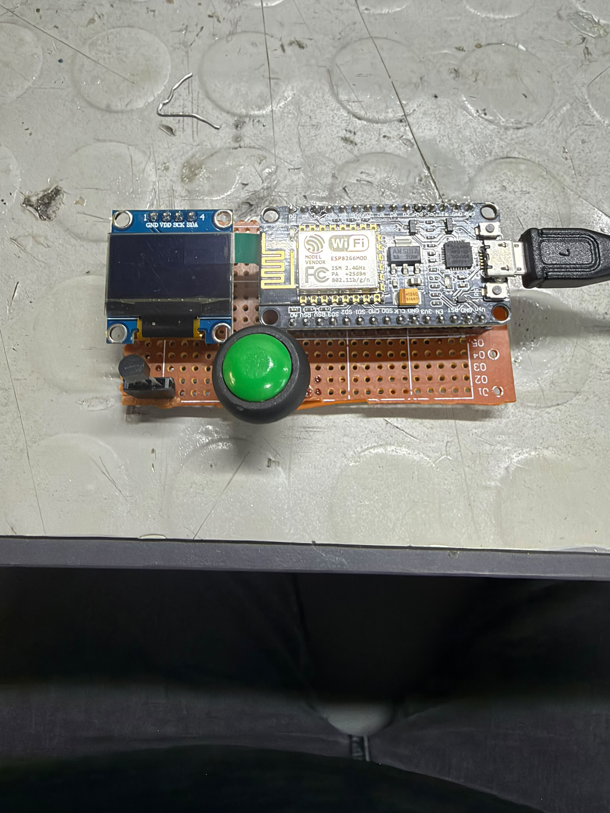
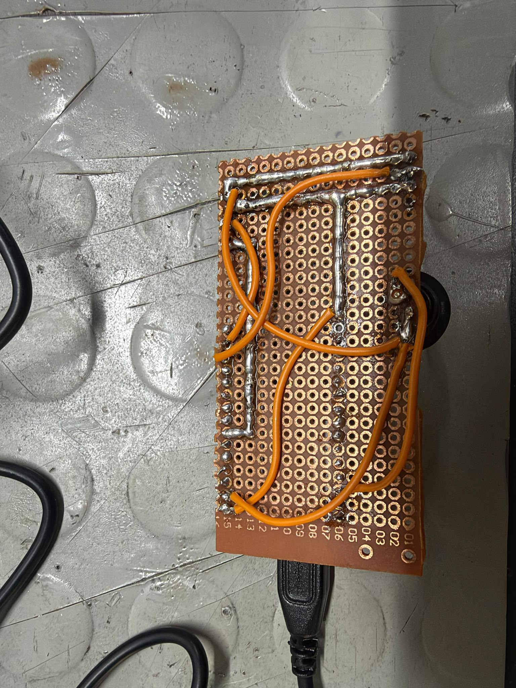

# dallas-temperature-sensor

i built this to find out which of the Dallas DS18B20 temperature sensors in the workshop actually worked. i tested them one at a time at room temperature. the perfboard has since been promoted to quality control.

a NodeMCU wakes up, asks a DS18B20 for one temperature reading, puts it on an OLED for three seconds, and goes back to sleep. the big green button is the only part that looks like it has a budget.

<p align="center">
  
  <br>
  <em>23.6 °C from the only working sensor in the batch. employee of the month.</em>
</p>

## the workshop test results

| Wrong reading | Sensor error |
| :---: | :---: |
|  |  |
| `-45.0 C` on a room-temperature bench. the workshop had applied for polar status. | `Sensor hatasi`. this one filed its complaint in Turkish. |

The firmware displays any reading from −55 to 125 °C, so spotting a wildly wrong room-temperature reading is up to whoever's holding the button.

## three seconds of public service

1. With USB power disconnected, connect one sensor. Power on or reset the board. The ESP8266 turns off Wi-Fi and looks for the OLED at `0x3C` or `0x3D`.
2. The first DS18B20 on the 1-Wire bus gets one question. The OLED shows `Sicaklik` (temperature) and the answer in Celsius to one decimal place. A missing or out-of-range reading gets `Sensor hatasi` (sensor error).
3. After three seconds the display goes dark and the ESP8266 enters deep sleep with no wake timer. Reset it for another reading. it has already done everything it came here to do.

## wire up the witness

Use a NodeMCU 1.0 (ESP8266), a DS18B20, a 128×64 I²C OLED, a 4.7 kΩ resistor, and a normally open momentary button. The firmware drives the SSD1315 panel in the build with U8g2's SSD1306-compatible driver.

| Part | Pin | NodeMCU |
| --- | --- | --- |
| OLED | `SCK` / `SCL` | `D1` (`GPIO5`) |
| OLED | `SDA` | `D6` (`GPIO12`) |
| OLED | `VDD`, `GND` | `3V3`, `GND` |
| DS18B20 | `DQ` | `D2` (`GPIO4`) |
| DS18B20 | `VDD`, `GND` | `3V3`, `GND` |
| Reset button | Switch contacts | `RST`, `GND` |

Put the 4.7 kΩ pull-up between `DQ` and `3V3`. Press and release the reset button to take another reading. [DS18B20 datasheet](https://www.analog.com/media/en/technical-documentation/data-sheets/ds18b20.pdf)

## give it a job

Install PlatformIO Core and connect the NodeMCU over USB. [PlatformIO quick start](https://docs.platformio.org/en/stable/core/quickstart.html)

```sh
git clone https://github.com/bitkicayi/dallas-temperature-sensor.git
cd dallas-temperature-sensor
pio run -e nodemcuv2
pio run -e nodemcuv2 -t upload
```

[platformio.ini](platformio.ini) pins the versions of U8g2, OneWire, and DallasTemperature. The entire shift takes place in [src/main.cpp](src/main.cpp).

## when the witness goes quiet

- **Black screen after three seconds.** That's deep sleep. Press and release reset to ask again.
- **Black screen from the start.** Open `pio device monitor -b 115200` and reset. `OLED bulunamadi` means the display didn't answer. Check power, ground, `D1` for clock, and `D6` for data.
- **`Sensor hatasi`.** Check the DS18B20 pinout, power, and the pull-up on `D2`. The thermometer has declined to speculate.

## evidence from the bench

| Between shifts | The underside |
| :---: | :---: |
|  |  |
| the screen has clocked out. | the orange wires know where they’re going. |
